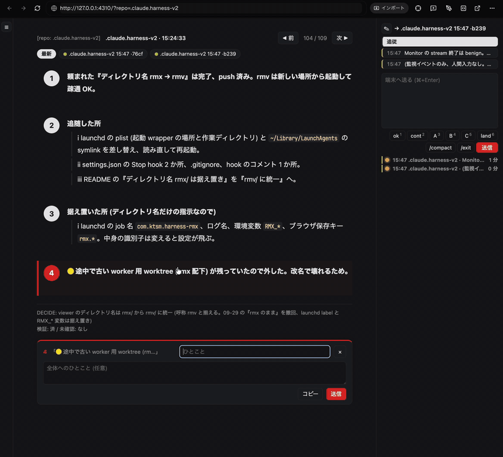
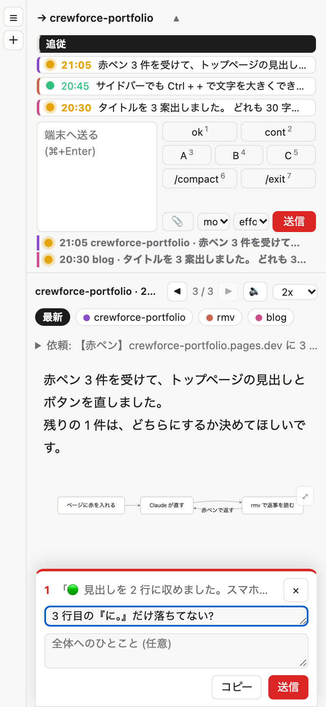
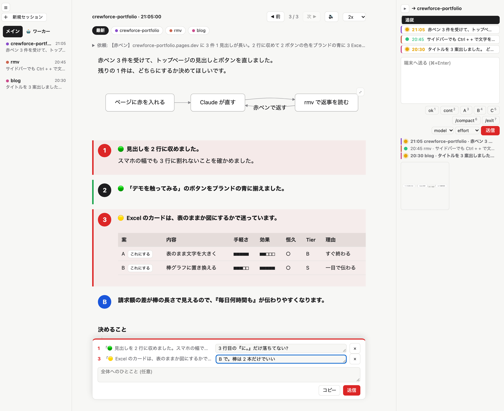
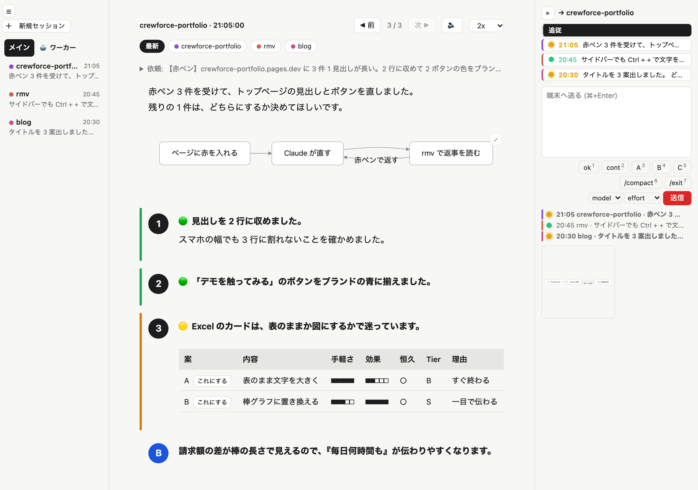
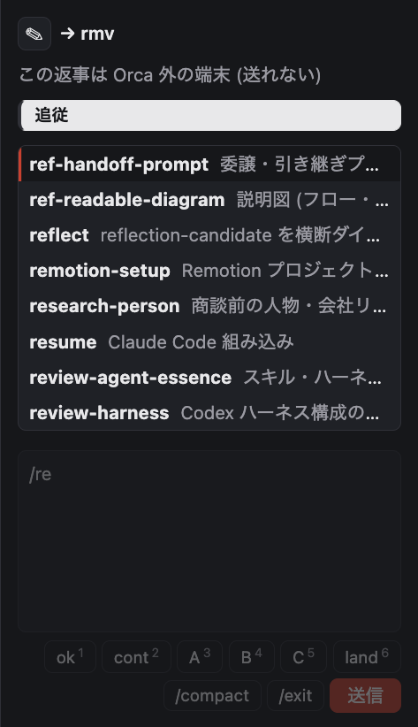
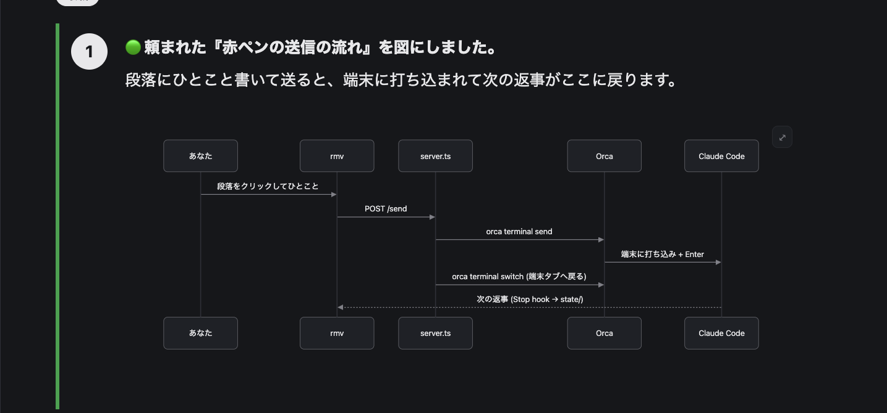
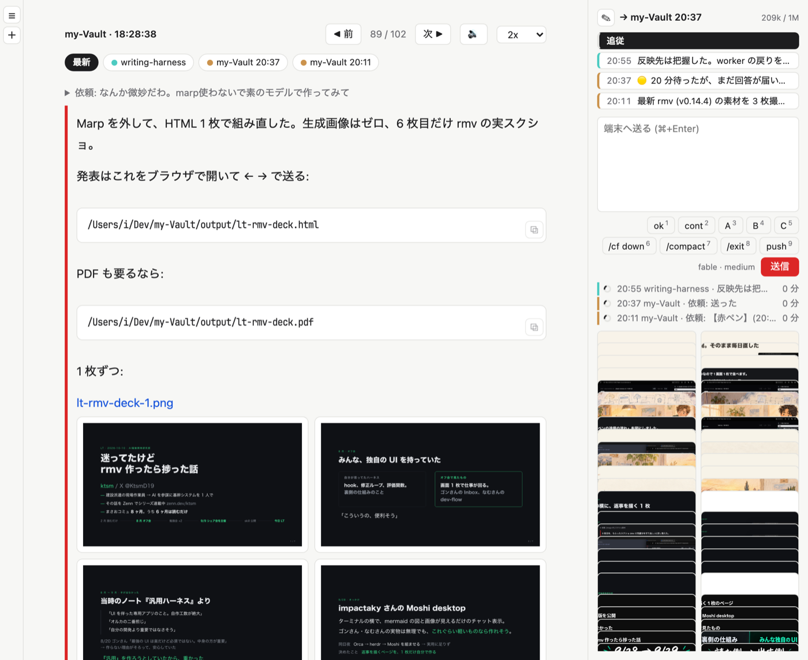
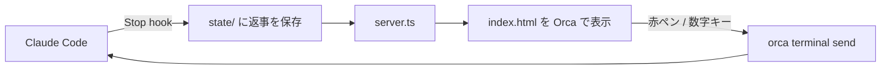

# rmv (Red Marker Viewer)


Claude Code の返事を「見て分かる」形に描き、赤ペンでそのセッションの端末へ返すビューアです。
[Orca](https://github.com/stablyai/orca) のフローティングブラウザや [herdr](https://herdr.dev) の pane と組み合わせると、赤ペンも許可ボタンもその端末に直接届きます (Orca だけ・herdr だけでも動きます。詳しくは [外部ツールとつなぐ](#外部ツールとつなぐ))。
（Chrome 等でも見れますが、vimium 等ショートカットの競合注意）

専用透過ブラウザ [RMV Float](float/README.md) (macOS ネイティブ) も同梱しています。
Tailscale で中継すれば、スマホからも同じ画面で返事を読み、赤ペンを返せます ([スマホなど別の端末から開く](docs/config.md#スマホなど別の端末から開く))。



[高画質の動画 (mp4)](docs/demo.mp4)



## なぜ作ったか

ターミナルの Claude Code では、返事に出てくる画像がその場で見られません。
mermaid の図も、コードのまま表示されます。
Orca には実験的なチャット表示がありますが、不安定です。
そこで、返事だけを描くページを横に置いたり、ショトカで表出させることにしました。

「赤ペン」は、まさおさんの [akapen](https://github.com/AI-Driven-R-D-Dept/akapen) へのリスペクトです。
akapen は、作る前に 1 案を人に見せて、赤 (回答・訂正) をもらってから作る skill です。
rmv では、その赤を入れる体験を毎回の返事に持ち込んでいます。

## 僕の使い方

Orca のフローティングブラウザに rmv を開いておきます。
キーは入力欄の外で押します。

| 操作 | 何が起きるか |
| --- | --- |
| `cmd+J` (Orca) | フローティングブラウザが開き、最新の返事が見える |
| `←` `→` | 返事の履歴をさかのぼる / 新しい方へ戻る |
| `↑` `↓` | セッションを切り替える |
| `1`〜`5` | そのセッションへ即返答 (1 = ok / 2 = continue / 3 = A / 4 = B / 5 = C) |
| `6`〜`0` | よく使うコマンドを送る (既定は 6 = /compact / 7 = /exit) |
| `y` | 許可待ちの「許可」ボタンを押す |
| 段落をクリック | 赤ペンのピンが立つ。ひとこと書いて送ると、そのセッションへ打ち込まれる |
| `⌘Enter` | 赤ペンやチャット欄に書いたものを送る |
| `Esc` | 赤ペンのピンを新しいものから 1 つ外す |
| `r` | 表示中の返事を読み上げる。もう一度押すと止まる |
| `Shift+R` | 読み上げを一時停止する。もう一度押すと続きから読む |
| `Ctrl+` `+` / `-` / `0` | 画面を拡大 / 縮小 / 元に戻す。拡大率は次に開いた時も残る (Chrome のサイドパネルでは `⌘+` がタブ側の拡大になるため) |
| ギャラリーのカードを押す | 全画面で開く。`←` `→` で前後へ、`Esc` で閉じる |

選択肢の表 (A / B / C) が出たら、`3`〜`5` を 1 回押すだけで返事ができます。
長い指摘は、段落ごとに赤ペンを付けてまとめて送ります。
`6`〜`0` には、自分のよく使うコマンドを置けます ([キーの割り当て](docs/config.md#キーの割り当て))。



### 画面の各部

左の列はプロジェクトの一覧で、ホバーで開きます。
複数の repo で Claude を並走させていても、返事が来た順に並びます。
＋ を押すと、選んだフォルダで新しい Claude Code を起動できます。



右のチャット欄からは、自由文をセッションへ送れます。
`/` を打つと skill とコマンドの候補が出ます。
クリップボードの画像は `⌘V` で貼れます。
送り先のモデル・エフォートと context の使用量も、ここに出ます。
送信ボタンの左のプルダウンで、送り先のモデル・エフォートを切り替えられます。
入力欄に書きかけがある時と、許可待ちの時は切り替えず、理由を出します。



右下のギャラリーには、セッションで使った画像・PDF と、返事に出てきた mermaid 図が新しい順に並びます。

## Low-Load 出力スタイルと組み合わせる

rmv は、同梱の出力スタイル [Low-Load](output-styles/low-load.md) の書式を、毎回同じ位置に描きます。

| 返事の書式 | rmv での見え方 |
| --- | --- |
| `1\.` `2\.` の段落番号 | 左の丸番号。段ごとにカードになる |
| `ⅰ` `ⅱ` の箇条書き | 字下げした項目 |
| 🔴 🟡 🟢 | 段の左の色帯 (🔴 は赤帯) |
| 1 列目が `A`〜`E` の表 | 表 + [これにする] ボタン |
| mermaid | 図として描画 (押すと全画面) |
| `検証:` `DECIDE:` の行 | 下端の小さな注記 |
| 画像・動画の絶対パス | その場に表示 |

![Low-Load の返事を描いたところ。段の丸番号と、案の表の [これにする]](docs/reply.png)

シーケンス図も、ターミナルでは出ない図としてそのまま描けます。



1 行に画像のパスを複数書くと、横に並べて表示します。
スクショの前後比較や、画面ごとに 1 枚ずつ並べる時に便利です。



出力スタイルの入れ方:

```bash
mkdir -p ~/.claude/output-styles
cp output-styles/low-load.md ~/.claude/output-styles/
```

Claude Code の `/config` で Output style に `Low-Load` を選びます。
書式を AI 任せにせず固定の型に寄せているので、ページの見た目が毎回ぶれません。

## 仕組み



AI には HTML を書かせません。
返事の markdown をそのまま保存し、決まった型のページが 2 秒ごとに取り込んで描きます。

## セットアップ

必要なもの: macOS / [Bun](https://bun.sh) / python3 / Claude Code / Orca (赤ペンと数字キーの送信に使う。無くても閲覧はできる)

1. clone して server を起動します。

   ```bash
   git clone https://github.com/ktsm-yt/rmv.git ~/rmv
   cd ~/rmv && bun run server.ts
   ```

2. Claude Code の `~/.claude/settings.json` の `hooks` に、返事を保存する hook を足します。
   パスは clone した場所に合わせてください。

   ```json
   {
     "hooks": {
       "Stop": [
         { "hooks": [{ "type": "command", "command": "python3 ~/rmv/hooks/stop-to-fragment.py", "timeout": 5 }] }
       ],
       "SubagentStop": [
         { "hooks": [{ "type": "command", "command": "python3 ~/rmv/hooks/stop-to-fragment.py", "timeout": 5 }] }
       ]
     }
   }
   ```

   `SubagentStop` は任意です。
   入れると、上部の「🤖 ワーカー」タブで subagent の報告も読めます。

3. Orca のフローティングブラウザで `http://127.0.0.1:4310` を開きます。

常駐させたい時は `bash launchd/install.sh` を実行してください (launchd に登録し、ログイン時に自動で起動します。ログは `~/Library/Logs/harness-rmv.log`)。

許可ボタン、依頼文の表示、スマホから開く、読み上げの声などの任意の機能は、[docs/config.md](docs/config.md) に入れ方があります。

## rmp とつなぐ

兄弟の [rmp (Red Marker Page)](https://github.com/ktsm-yt/rmp) は、見ているページや PDF に赤を入れて Claude Code へ送る Chrome 拡張です。
rmv が『返事に赤を入れる』側、rmp が『ページに赤を入れる』側で、2 つを組むと、赤を入れる → 直る → 返事を見る → また赤を入れる、がブラウザの 1 画面で回ります。

- rmp のサイドパネルに rmv が出ます。いま動いている全部のセッションが並ぶので、ページから離れずにどの agent の返事も読めて、注釈の宛先も選べます。
- rmp で送った注釈は、rmv が宛先のセッションの端末に `/rmp <ticket>` を打ち込んで、その場で会話へ届きます (『今すぐ』)。


つなぐには、rmv の `state/env` に rmp の origin を 1 行書いて rmv を起動し直します (仕組みは次の節)。

```sh
RMV_EXT_ORIGINS=chrome-extension://kgdkanfbaiakfcncpfdllehhenoplheg
```

## 外部ツールとつなぐ

### Orca / herdr と組む

- **Orca**: フローティングブラウザに rmv を開き、`cmd+J` で出し入れします。赤ペンと許可ボタンは Orca の端末へ届きます。
- **herdr**: Orca の端末の中で herdr を使っている時も、Orca 無しで herdr だけの時も、herdr の pane で動く Claude が一覧に出て、赤ペン・許可ボタン・新規セッションがその pane に直接届きます。pane が閉じていたり Claude が居なければ、別の pane には送らずエラーにします (`herdr` コマンドが必要。場所を変えるなら `RMV_HERDR_BIN`)。
- 細かい挙動 (pane ごとの一覧・題名・生死の取り方) は [docs/config.md](docs/config.md) にあります。

### 一覧を読む

別のツールから、今動いている Claude のセッションの一覧を読めます (読み取りだけ)。

```bash
curl -s http://127.0.0.1:4310/sessions
```

- 1 セッション 1 行で、最新の返事のセッション ID・端末・フォルダ・herdr の pane 名・冒頭 40 字・状態・時刻と、その端末へ送れるかどうか (許可のダイアログや質問への答えを待っている間は送れない扱い) を返します。
- 「🤖 ワーカー」側に出る会話 (foyer の画面・herdr の tab 2 以降) は載せません。
- 依頼文は返しません。
- 応答ヘッダの `x-rmv-live` が `unknown` の時は、Orca と herdr の一覧が取れず、生死を確かめられていません。
- 他の口と同じく、Host が `127.0.0.1:4310` / `localhost:4310` (と `RMV_ORIGINS`) 以外なら 403 です。
  CORS のヘッダは付けないので、Web ページからは読めません。

### 端末へ合図を送る (opt-in)

外部ツールから、上の一覧で選んだセッションの端末へ、受付番号の付いたスラッシュコマンド 1 行と Enter を打ち込めます。
既定では閉じています。使う時は、許可するツールの origin を `RMV_EXT_ORIGINS` に書きます (複数はカンマ区切り)。

```bash
# launchd で常駐させている時は state/env に書く
RMV_EXT_ORIGINS=chrome-extension://<拡張の ID>
```

書いたら rmv を起動し直します (`launchctl kickstart -k gui/$(id -u)/com.ktsm.harness-rmv`)。

- 許可した origin からの `POST /ext/deliver` だけを受けます。本文は `{"sid": "<セッション ID>", "ticket": "<YYYYMMDD-HHMMSS-NNNNNN>"}` だけで、打ち込む文字は rmv が ticket から組み立てます。ツールから文字は受け取りません。
- 送り先の端末で今動いている会話が、そのセッションでなければ 409 (本文が `stale` で始まる) を返して打ち込みません。同じ端末で別の会話を開き直した時も、`/clear` や `/resume` で会話を切り替えた直後 (まだ何も依頼していない間) も同じです。今の会話は、端末の Claude のプロセスごとの記録 (`~/.claude/sessions/<pid>.json`、Claude Code の非公開の形式) で確かめます。
- 送り先の Claude が許可のダイアログや質問への答えを待っている間は、409 (本文が `permission pending` で始まる) を返して打ち込みません。打つと先頭の数字がダイアログの選択肢として選ばれるためです。上の一覧の `deliverable` も、その間は `false` です。
- 送り先の端末の入力欄に書きかけ (上キーで呼び出した履歴を含む) がある時は、409 (本文が `draft` で始まる) を返して打ち込みません。続けて打つと、書きかけと合図が 1 つの依頼として送られるためです。入力欄は端末の画面 (herdr は見えている画面、Orca は描画された画面) の最後の 2 本の罫線の間で読みます。
- 端末で今動いている会話や入力欄を確かめられない時 (Claude のプロセスや記録が見つからない、`ps` が失敗する、画面に入力欄が見つからない) は、409 (本文が `unverified` で始まる) を返して打ち込みません。
- 端末が閉じている、またはその端末の Claude が終わっている時も 409 で、同じフォルダの別の端末へは差し替えません。「🤖 ワーカー」側の会話も 409 です。端末への送信が失敗した時は 502 です。成功すると `{"ok": true, "via": "orca" | "herdr"}` を返します。
- ツールが応答を待たずに接続を切った時は、打ち込む前に止めます (ツールが手で貼る道に回った後で、同じ合図が 2 回届かないように)。
- 端末タブへの切り替えはしません。
- `RMV_EXT_ORIGINS` は `RMV_ORIGINS` とは別物です。ここで許可した origin でも、赤ペンの送信やファイルを開くなどの他の口は使えません。未設定なら `/ext/` の口はすべて 403 です。

## 注意

- server は `127.0.0.1` だけで待ち受けます。
  認証は無いので、LAN に公開しないでください。
- 返事に出てきた画像・動画・PDF を表示するため、ホーム配下と一時ディレクトリのファイルを読みます。
- 返事の履歴は `state/` に直近 200 件まで残ります。

テスト:

```bash
bash test/akapen.test.sh
```

## ライセンス

MIT
