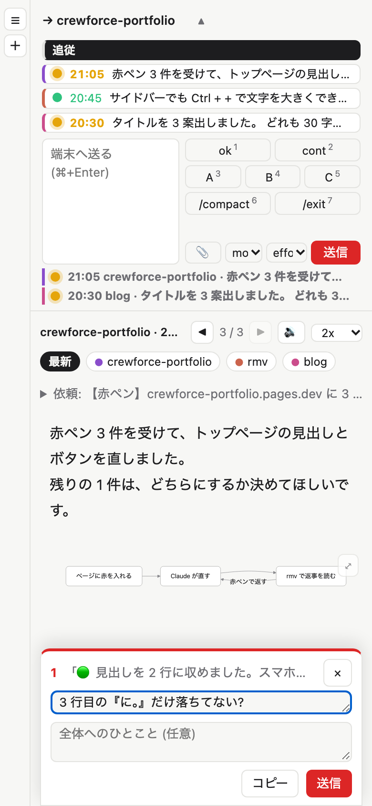
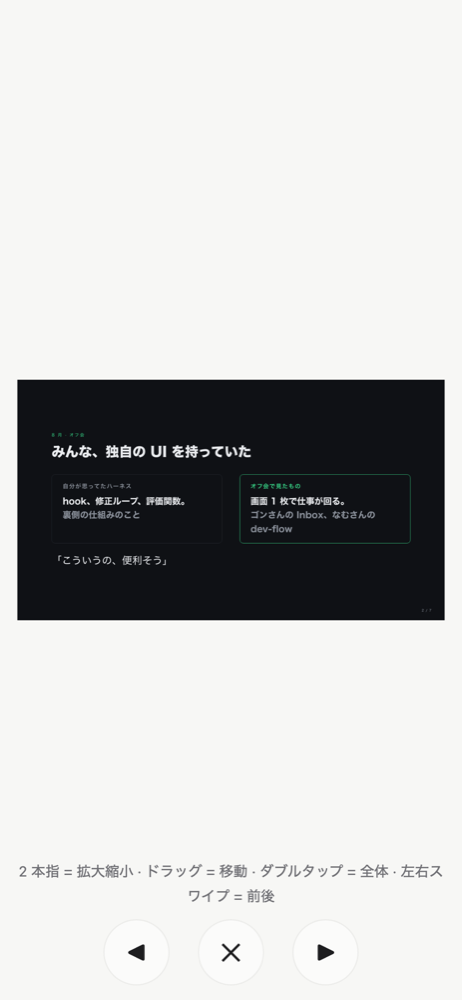

# 細かい設定と任意の機能

README の続きです。
どれも入れなくても rmv は使えます。

## キーの割り当て

`state/keys.json` に書くと、数字キーとボタンを置き換えられます。

```json
{"6": "/cf down", "7": "/compact", "8": "/exit"}
```

ページを開き直すと反映されます。
`""` を書くと、その番号の既定を消します。
`1`〜`5` も同じ書き方で置き換えられます。
`"models": ["sonnet[1m]", "opus[1m]"]` と書くと、モデルのプルダウンの候補がその並びになります (既定は sonnet / opus / haiku / fable)。
`state/` は git に入りません。

キー操作の細かい挙動:

- `↑` `↓` は、チャット欄が空なら欄の中でも使えます。`1`〜`0` は欄の外だけです。
- 赤ペンを送ると、Orca はそのセッションのタブに移ります。
- Orca の端末の中で [herdr](https://herdr.dev) を使っている時は、赤ペンも許可ボタンもそのセッションの pane に直接届きます。pane が閉じていたり Claude が居なければ、別の pane には送らずエラーにします (`herdr` コマンドが必要。場所を変えるなら `RMV_HERDR_BIN`)。 一覧のまとめ・許可待ち・入力中の依頼も herdr の pane ごとに分け、題名と生死も herdr から取ります (同じ Orca 端末の別 pane は別のセッション。herdr に出力時刻は無いので、その行の時刻は出ません)。
- Orca が無く herdr だけで使う時も、herdr の中で動く Claude (`HERDR_ENV=1` と `HERDR_PANE_ID` が入っている) は一覧に出て、赤ペン・許可ボタン・新規セッションが herdr の pane に届きます。新規セッションで選べるフォルダは、Orca の worktree 一覧が取れない時だけ herdr に開いてある pane のフォルダになります。
- `Esc` は、ひとことを書いたピンで止まります。
- `y` は、送り先のセッションの許可待ちを押します。送り先に許可待ちが無い時は、許可待ちが 1 つだけならそれを押します。
- `/` の候補の出どころは、送り先の repo の skill・自分の skill・plugin・組み込みコマンドの 4 つです。`↑` `↓` で選び、`Tab` か `Enter` で入ります。

## チャット欄の表示

送信ボタンの左には、送り先のモデルとエフォートが「opus · high」の形で出ます。
表示するだけで、切り替えは Orca か端末で行います。
端末で直接変えた分は、次の返事で反映されます。
モデルが transcript から分からない時は settings の `"model"` を読みます。順は Claude Code と同じで `<送り先の cwd>/.claude/settings.local.json` → `<cwd>/.claude/settings.json` → `~/.claude/settings.json` (最後の場所は環境変数 `RMV_CC_SETTINGS` で変えられます)。

見出しの右には、context の使用量が「268k / 1M」の形で出ます。
30% 以上で黄、50% 以上で赤になります。

## ギャラリー

図も画像も、セッションで出てきた順に混ぜて、新しいものから並べます。
図は直近 30 件の返事から最大 20 枚です。
PDF は押すと新しいタブで開きます。

## 許可ボタンを使う

許可ダイアログで止まった端末を状態行に出し、「許可」ボタンか `y` で通せるようにします。
`~/.claude/settings.json` の `hooks` に `perm-state.py` を足します。

```json
{
  "hooks": {
    "PermissionRequest": [
      { "hooks": [{ "type": "command", "command": "python3 ~/rmv/hooks/perm-state.py", "timeout": 5 }] }
    ],
    "PostToolUse": [
      { "hooks": [{ "type": "command", "command": "python3 ~/rmv/hooks/perm-state.py", "timeout": 5 }] }
    ],
    "Stop": [
      { "hooks": [{ "type": "command", "command": "python3 ~/rmv/hooks/stop-to-fragment.py", "timeout": 5 }, { "type": "command", "command": "python3 ~/rmv/hooks/perm-state.py", "timeout": 5 }] }
    ],
    "UserPromptSubmit": [
      { "hooks": [{ "type": "command", "command": "python3 ~/rmv/hooks/perm-state.py", "timeout": 5 }] }
    ]
  }
}
```

`Stop` は、README で足した返事保存と同じ配列に並べます。
別の `Stop` を書くと上書きになります。

## 依頼文を返事の上に出す

`UserPromptSubmit` の配列に `python3 ~/rmv/hooks/prompt-state.py` を並べます。
送った依頼文が、返事の上に 1 行で出ます。
返事が来るまでは、右欄の状態行に「依頼: 冒頭…」と出ます。

`SessionStart` に `"matcher": "startup"` で `python3 ~/rmv/hooks/session-wait.py` を並べると、起動した直後のセッションも右欄に「待機中」と出ます。
その行を押せば、スマホからでも最初の依頼を送れます。

## 新しいセッションを起動する

左の列の ☰ の真下にある ＋ を押すと、フォルダの一覧が開きます。一覧の元は Orca の worktree 一覧で、Orca から取れない時は herdr に開いてある pane のフォルダです。
行を押すと、そのフォルダでまっさらな Claude Code が herdr の pane で起動します (そのフォルダの空いた shell の pane があればそこで、無ければ同じフォルダの pane を下に分割し、そのフォルダの pane が無ければ workspace を新しく作ります)。
herdr が止まっている時や、分割・起動に失敗した時は、Orca の端末には落とさず、理由を画面に出します。
一覧は herdr の workspace の番号順に並びます (herdr で並べた順がそのまま一覧の順になります)。
今選んでいるプロジェクトの行は色と『選択中』の印が付くだけで、先頭には移りません。
どの workspace にも無いフォルダは後ろに置き、その中は最近返事があった順です。
herdr が動いておらず Orca だけの時は、Orca が返す順のままです。

- `RMV_NEW_CMD`: herdr の pane で走らせるコマンド (既定 `claude`)

## スマホなど別の端末から開く

rmv は Mac の中 (`127.0.0.1`) でしか待ち受けません。
別の端末から開く時は、Tailscale の `tailscale serve` に中継させ、その URL を環境変数 `RMV_ORIGINS` で許可します。

```bash
tailscale serve --bg 4310                # https://<Mac の名前>.<tailnet>.ts.net → 127.0.0.1:4310
RMV_ORIGINS=https://<Mac の名前>.<tailnet>.ts.net bun run server.ts
```

launchd で常駐させている時は、`RMV_ORIGINS=…` の行を `state/env` に書けば起動スクリプトが読みます。
外部ツールに端末へ合図を送らせる `RMV_EXT_ORIGINS` も同じ `state/env` に書けます (README の「外部ツールとつなぐ」)。
届くのは同じ Tailscale につながった端末だけです。
返事の中のファイルを開くボタンは、押した端末には出ず、Mac の画面で開きます。

スマホでは、操作が画面の下端の 1 本 (一覧・送り先・前後・新規) にまとまり、送り先を押すと送信欄が下から開きます。
折りたたみを開いた画面など幅が広い時 (600px 以上) は、左に返事、右に送信欄の 2 列になります。
赤ペンは PC と同じで、段をタップしてひとことを添えます。



画像や図をタップすると全画面になり、左右スワイプか ◀ ▶ で前後の画像に移れます。



## 読み上げの声

🔊 は既定で Gemini の読み上げモデルで声を作ります。
キーは macOS のキーチェーンに入れます (値は対話で入力するので、シェルの履歴に残りません)。

```bash
security add-generic-password -U -a "$USER" -s rmv-gemini -w
```

環境変数 `GEMINI_API_KEY` に入れても使えます。
キーが無い時や Gemini が失敗した時は、ブラウザ内蔵の声で読みます。
Android の Chrome の内蔵の声は一時停止できません。

無料枠のキーでは、送った文章が Google の製品改善に使われます。
有料か無料かは、キーの属する Google Cloud プロジェクトの支払い設定で決まります。

🔊 ボタンの操作:

- 読み上げ中に押すと一時停止 / 再開、長押しで止まります。
- 速さは隣で 1x〜3x から選びます (既定 2x、選んだ値を覚えます)。
- コード・表・図は読みません。

環境変数:

- `RMV_TTS_MODEL`: 読み上げモデル (既定 `gemini-3.1-flash-tts-preview`。`gemini-3.8-flash-tts` は声が良いが無料枠が 1 日 10 回)
- `RMV_TTS_VOICE`: 声 (既定 `Kore`)
- `RMV_TTS_STYLE`: 話し方の指示 (既定 `落ち着いて、はっきりと`。3.8 のときだけ効く)

ローカルの [VOICEVOX ENGINE](https://github.com/VOICEVOX/voicevox_engine) を使う時は、起動した ENGINE に合わせて次を設定します。Gemini のキーは不要です。

```bash
RMV_TTS_PROVIDER=voicevox
RMV_VOICEVOX_URL=http://127.0.0.1:50021
RMV_VOICEVOX_SPEAKER=3 # ずんだもん / ノーマル
```

`RMV_TTS_PROVIDER` を設定しなければ Gemini のままです。

## Codex の返事を載せて赤ペンを返す (試作・opt-in)

右側の『HerdrのCodex』からペインを選ぶと、端末にいま表示されている画面が左に開きます。Codexの設定や返信履歴がなくても、待機中で端末の入力欄が空なら右から1行のテキストを送れます。端末に書きかけがある場合や作業中は送信を止めます。

送り先は選んだ時の端末です。端末が入れ替わったら選び直してください。Herdrでは入力欄の確認と送信を一度にできないため、送信ボタンを押した直後に同じ端末で入力を始めると内容が重なることがあります。履歴から会話を選ぶと、会話IDへのキュー送信を使います。

Codexの返事を一覧に出せます。段落に付けた赤ペンも、右の送信欄に書いた依頼も、選んだCodexの会話に届きます。
返事の保存と送信を使う時は、Codexの `~/.codex/hooks.json` の `Stop` に保存用のhookを足します。

```json
{ "hooks": [{ "type": "command", "command": "python3 ~/rmv/hooks/codex-stop.py", "timeout": 10 }] }
```

足した後、Codex が hook の確認を出したら信頼してください。

- 一覧には『Codex:』と付いて出ます。本文に番号や見出しがなくても、段落を押して赤ペンを付けられます。端末の稼働状態や外部ツール (rmp) の送り先は Claude Code 用です。
- Codex の記録が対話セッション (`cli` または `vscode`) を示す返事を載せます。herdr の pane で対話版として動かした委譲 worker も表示されます。
- 赤ペンの送信は端末に打たず、`codex queue --thread <会話の ID> --message=<本文>` で Codex 自身のキューに積みます。送り先の ID は記録から取り、同じフォルダの別の会話に回すことはしません。
- 積めたら『キューに登録』と出ます。登録した赤ペンをいつ処理するかは Codex が決めます。失敗したら下書きが残ります。時間切れや通信の切断があった時は、登録されているか Codex 側で確かめてください。
- 右の送信欄では、表示中の会話に追従するか、一覧からCodexの会話を送り先に固定します。下書きは会話ごとにブラウザのタブ内に残ります。
- Codexに送れるのは文字だけです。ファイル添付、数字キー、コマンドの補完、モデルの切り替え、許可ボタンはClaude Codeの会話で使えます。
- launchd で常駐させている時、server は `/opt/homebrew/bin/codex` を使います。別の codex を使うなら `state/env` に `RMV_CODEX_BIN=<パス>` を書きます。

## 返事に出てきたファイルの扱い

画像・動画・PDF などは、ホーム配下と一時ディレクトリにあればページの中に表示します。
`.md` や `.code-workspace` などは読まずに、Mac の既定アプリで開きます。
スクリプト (`.sh` `.py`、実行ビット付き、`#!` 始まり) は実行させないよう、`RMV_EDITOR_APP` (既定 `Visual Studio Code`) で開きます。

## ポート

既定は `4310` です。
環境変数 `RMV_PORT` で変えられます。
